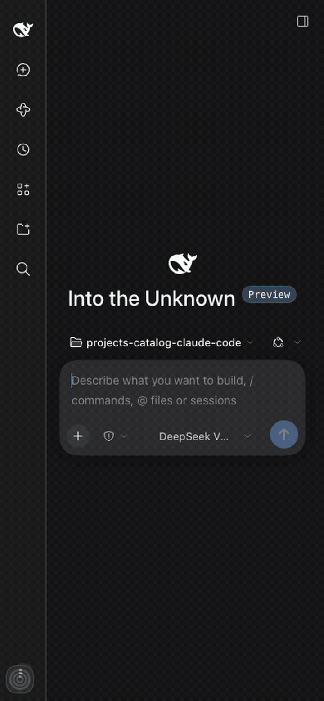
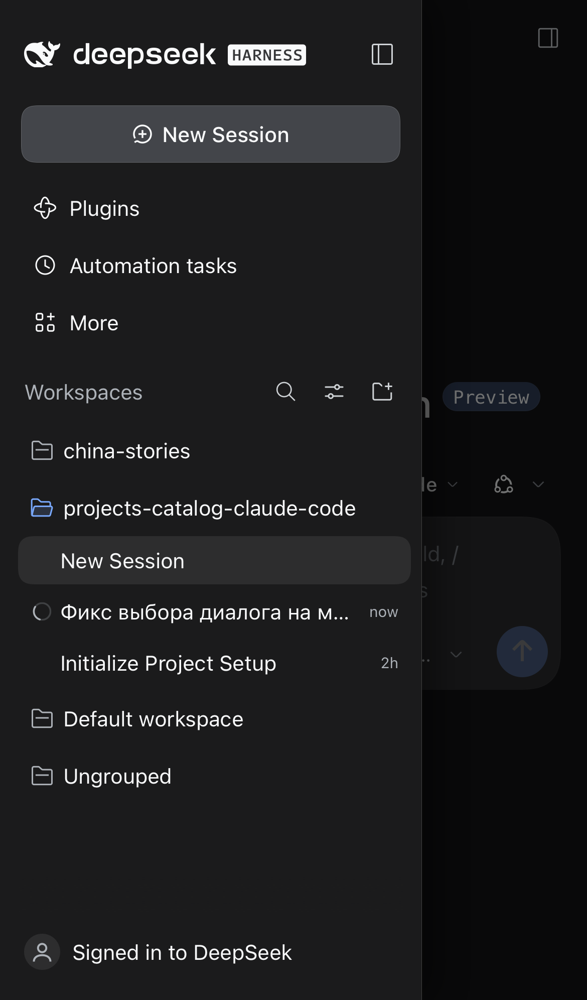
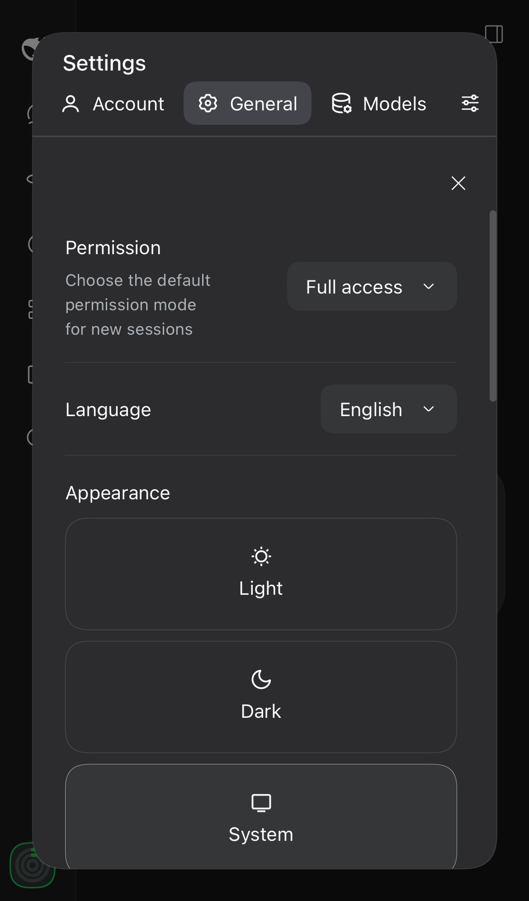
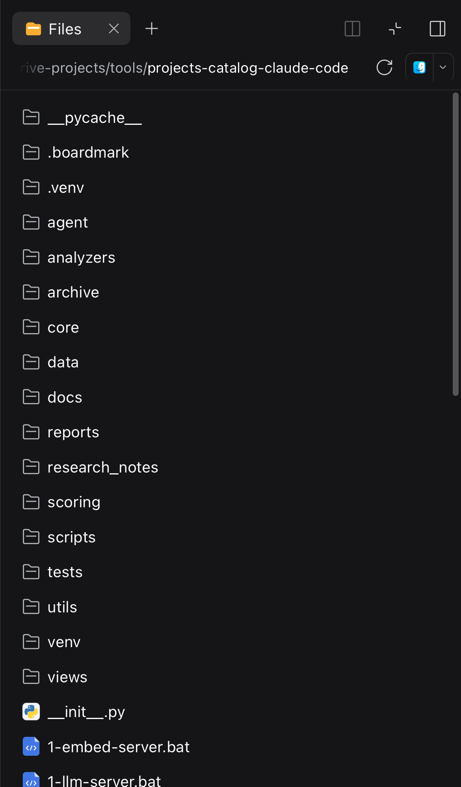
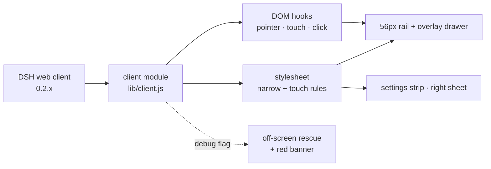

<div align="center">

# DSH Mobile UI

[](#compatibility)
[](LICENSE)
[](#how-it-works)
[](#what-it-fixes)
[](#install)

</div>

<table>
<tr>
<td width="360" valign="top">

</td>
<td valign="top">

<p><strong>A phone-first fix for the DeepSeek Harness Web UI — a real drawer, edge swipes, readable settings and a working right panel, without touching the core.</strong></p>
<p>DSH 0.2.x is desktop-first: three-column grid, a 188px settings nav, a right panel that collapses to a 0px track, and a 14px composer that makes iOS zoom the page. On a 390px phone that leaves a sliver of chat, a settings dialog you cannot read, and no way to reach Files or the code viewer.</p>
<p>This plugin patches the client bundle from the outside. The Host half is empty, no core file is copied or modified, and the desktop layout is untouched.</p>
<ul>
<li><strong>No more iOS auto-zoom</strong> — 16px fields on any touch device, even when the phone shows a wide desktop layout.</li>
<li><strong>The chat keeps the width</strong> — the sidebar becomes a 56px rail plus an overlay drawer.</li>
<li><strong>One tap opens a session</strong> — the row's click is dispatched from <code>pointerup</code>, before iOS can drop it.</li>
<li><strong>Edge swipes</strong> — left edge opens, swipe left closes.</li>
<li><strong>Settings you can read</strong> — sections become a horizontal strip, content takes the full panel.</li>
<li><strong>Files, terminal and code viewer work</strong> — the right panel is a full-screen sheet on a phone.</li>
</ul>

</td>
</tr>
</table>


---

## What it fixes

| Sidebar drawer | Settings | Files and code |
| --- | --- | --- |
|  |  |  |

1. **iOS auto-zoom.** Safari zooms a focused field under 16px. All `input` / `textarea` / `contenteditable` become 16px on touch devices; the check is the *device* (`html.dsh-mf-touch`), not the viewport width, so a phone showing a stretched desktop layout does not zoom either. `touch-action: manipulation` keeps double taps from moving the next tap off its target.
2. **The chat keeps the full width.** The sidebar column stays a 56px rail; the open panel becomes a fixed overlay drawer with a dimmed, blurred scrim.
3. **The drawer closes** when you pick a session, when you tap outside it, and by its own close button. The bottom safe area is respected.
4. **Session rows open on the first tap.** iOS treats a plain `<div role="treeitem">` with a React handler as "not clickable" and holds its click for the double-tap window (~300ms). Closing the drawer first unmounted the row, so the tap only closed the menu. The row's click is now dispatched synchronously from `pointerup`, and the late native click of the same tap is swallowed.
5. **Edge swipes.** Swipe from the left edge to open, swipe left to close. Vertical drags stay with the scroller (36px threshold, 34px vertical drift, 24px edge zone).
6. **Settings fit the phone.** The desktop dialog keeps a 188px nav column next to the content — on a 390px screen that left ~150px. On narrow screens the section list becomes a horizontal, scrollable strip above the content.
7. **The right panel works.** Its grid track is 0px on a phone, so Files, Terminal and the file/code previews opened into nothing. While open (`data-sidebar-right-open`) it becomes a full-screen sheet.
8. **Code and tables stay inside the message** and scroll on their own; code in the file viewer is 12px instead of 11px.
9. **The iOS keyboard accessory bar no longer sticks.** In a standalone PWA iOS can leave the previous/next/Done bar pinned at the bottom after the keyboard is dismissed; the plugin drops the field's focus when the keyboard closes.

## Install

```sh
git clone https://github.com/zven73/dsh-mobile-ui.git ~/.dsh/local-plugins/dsh-mobile-ui
dsh plugin --profile web add ~/.dsh/local-plugins/dsh-mobile-ui
```

`dsh plugin` needs `pnpm` on `PATH`. Restart `dsh web` (or let the profile re-compose) and reload the page on the phone. Client bundles are served from disk with a content revision, so later updates only need a page reload.

> The package id stays `dsh-mobile-fix` (the repository was renamed); that is the name you will see in `~/.dsh/profiles/web/package.json`.

### Uninstall

```sh
dsh plugin --profile web remove dsh-mobile-fix
```

## How it works



The package is a plain DSH client plugin: `cordis.patch.yml` inserts one empty Host row, and `lib/client.js` is the browser bundle DSH serves through `dsh.client`. Everything it does is CSS and DOM events:

- selectors use the stable halves of the CSS-module names (`sidebarCol`, `centerCol`, `rightbarCol`, `sessionRow`, `_root`, `_collapsed`, `toggle`) and the public `data-slot` names;
- the phone layout is behind `@media (max-width: 1023px)`, the 16px field rule is behind a touch-device class;
- one registered listener set per page — a second `apply` (HMR, live composition) replaces the previous one instead of stacking.

## Compatibility

| DSH | Profile | Checked on | Status |
| --- | --- | --- | --- |
| `0.2.1-rc.5` | `web` | iPhone 14 viewport (390×844, WebKit) + a real iPhone PWA | tested |
| other `0.2.x` | `web` | — | expected to work; a large layout redesign may need selector updates |
| desktop ≥ 1024px | `web` | macOS Chrome / Safari | untouched by design |

## Troubleshooting

| Symptom | What to do |
| --- | --- |
| Page still looks desktop on the phone | Reload the page; check the plugin is in the `web` profile (`~/.dsh/profiles/web/package.json` → `bundles`) |
| Settings does not open, or opens off-screen | `localStorage.setItem('dsh-mobile-fix-debug', '1')`, reload, read the red banner |
| iOS still zooms on a field | Make sure the build is 0.6.2+ — the rule keys off the touch device, not the width |
| Drawer does not close on a tap | Try a real phone: desktop browser emulation fires `click` differently |
| Right panel is blank | Open it from the session header; the sheet is per session, not global |
| Session tap selects but does not open | Check the console for a JS error; the fix dispatches `click` from `pointerup` |

## Limitations

- Selectors rely on CSS-module local names; a major redesign will need an update.
- The right panel is presented as a sheet on phones, not resizable.
- No service worker, no Host code: this is a client module only.
- Checked on iOS; Android Chrome should work (the layout rules are width-based) but is not tested.

## Development

| Path | What it is |
| --- | --- |
| `lib/client.js` | the whole browser bundle: stylesheet, drawer logic, swipes, settings sheet |
| `lib/index.js` | empty Host half (a valid Loader entry) |
| `cordis.patch.yml` | inserts the plugin row into the profile |
| `docs/` | screenshots and the demo GIF used by the READMEs |

Edit `lib/client.js`, bump `VERSION` and `package.json`, reload the page — the Host recomposes the bundle per request and the URL carries a content revision. There is no build step.

## Contributing

Issues and PRs are welcome. Please describe the device, the DSH version and what exactly you saw; a screenshot of the phone helps more than a paragraph. For a fix, keep the desktop layout untouched and test at 390×844 before sending.

## Changelog

See [CHANGELOG.md](CHANGELOG.md).

## License

MIT — see [LICENSE](LICENSE).

---

English · [Русский](README.ru.md) · [中文](README.zh.md)
