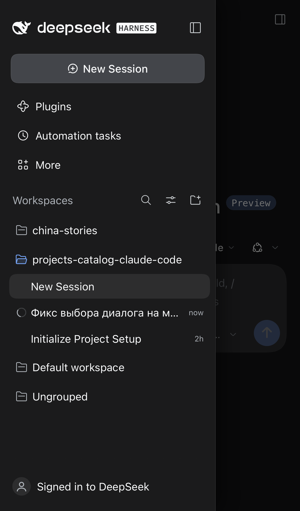
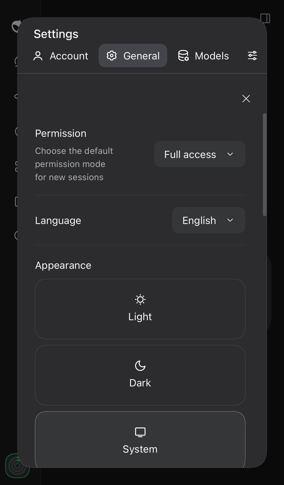
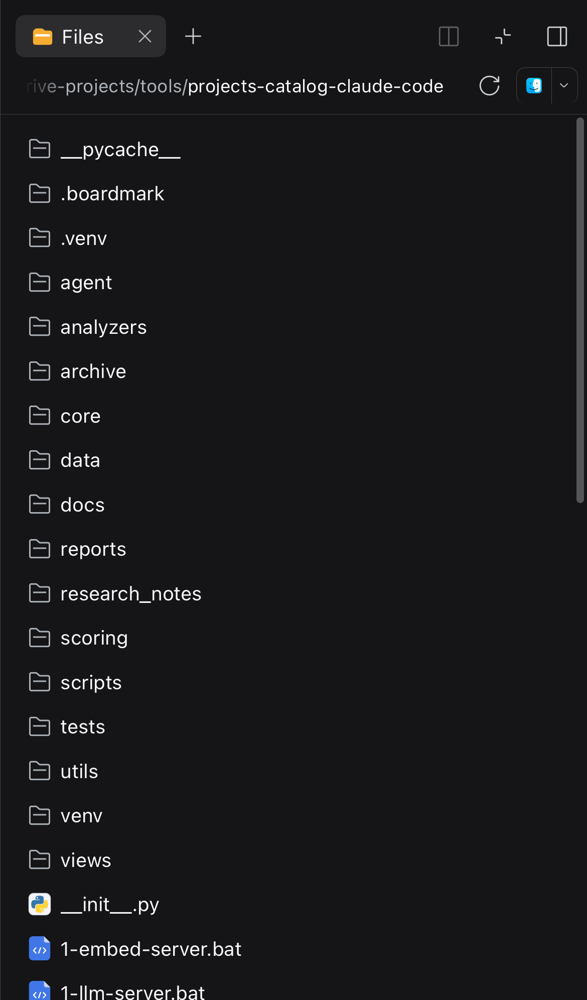

# DSH Mobile UI

Браузерный плагин, который делает Web UI [DeepSeek Harness](https://github.com/deepseek-ai/deepseek-harness)
пригодным на телефоне. Рассчитан на установленное iOS PWA, работает на любом
узком экране, десктопную раскладку не меняет.

| Дровер | Настройки | Файлы и код |
| --- | --- | --- |
|  |  |  |

DSH `0.2.x` — десктопный: три колонки, навигация настроек в 188px, правая
панель нулевой ширины, композер 14px, из-за которого iOS зумит страницу. На
экране 390px от чата остаётся полоска, а настройки не читаются. Плагин
патчит клиентский бандл снаружи: Host-половина пустая, файлы ядра не
копируются и не правятся.

## Что чинит

1. **Нет автозума iOS.** Safari зумит страницу, когда в фокус попадает поле
   меньше 16px. На тач-устройстве все `input` / `textarea` / `contenteditable`
   становятся 16px; признак — устройство (`html.dsh-mf-touch`), а не ширина
   окна, поэтому работает и когда телефон показывает широкий десктопный макет
   (трансляция растянутого экрана Mac). `touch-action: manipulation` не даёт
   двойному тапу сдвигать следующий тап мимо цели.
2. **Чат на всю ширину.** Колонка сайдбара остаётся рейлом 56px, открытая
   панель — фиксированный дровер поверх контента с затемнением и blur.
3. **Дровер закрывается** при выборе сессии, тапе вне панели и по своей кнопке
   закрытия. Нижняя safe-area учитывается.
4. **Строка сессии открывается с первого тапа.** iOS считает обычный
   `<div role="treeitem">` с React-обработчиком «некликабельным» и придерживает
   его `click` на окно двойного тапа (~300 мс). Дровер закрывался раньше и
   размонтировал строку, поэтому тап только закрывал меню. Теперь `click`
   строки отправляется синхронно из `pointerup`, до любых перестроек, а
   запоздавший нативный `click` того же тапа гасится.
5. **Свайпы от края.** Слева вправо — открыть, справа налево — закрыть.
   Вертикальные жесты остаются скроллу (порог 36px, вертикальный уход до 34px,
   зона края 24px).
6. **Настройки влезают.** Десктопная модалка держит 188px-колонку навигации —
   на 390px контенту оставалось ~150px. На узком экране список разделов
   становится горизонтальной прокручиваемой полосой над контентом.
7. **Правая панель работает.** На телефоне её колонка нулевая, поэтому Files,
   терминал и просмотр файлов/кода открывались в никуда. Пока панель открыта
   (`data-sidebar-right-open`), она разворачивается в полноэкранный лист.
8. **Код и таблицы** не расширяют сообщение и скроллятся внутри блока; код в
   просмотрщике файлов — 12px вместо 11px.
9. **Клавиатурная панель iOS не залипает.** В standalone-PWA iOS может
   оставить внизу панель «переход по полям + Готово» после скрытия клавиатуры;
   плагин снимает фокус с поля, когда клавиатура закрывается, и панель уходит.

## Установка

```sh
git clone https://github.com/zven73/dsh-mobile-ui.git ~/.dsh/local-plugins/dsh-mobile-ui
dsh plugin --profile web add ~/.dsh/local-plugins/dsh-mobile-ui
```

Для `dsh plugin` нужен `pnpm` в `PATH`. Перезапусти `dsh web` (или дай профилю
пересобраться) и обнови страницу на телефоне. Клиентские бандлы отдаются с диска с ревизией по содержимому, так что
для следующих обновлений достаточно перезагрузить страницу.

> id пакета остался `dsh-mobile-fix` (репозиторий переименован) — не удивляйся
> этому имени в `~/.dsh/profiles/web/package.json`.

## Удаление

```sh
dsh plugin --profile web remove dsh-mobile-fix
```

## Отладка

Если панель настроек не появилась (или оказалась вне экрана), включи

```js
localStorage.setItem('dsh-mobile-fix-debug', '1')
```

и перезагрузи страницу: красная плашка напишет, что произошло, а панель,
уехавшую за пределы экрана, прокрутит в видимую область. Без флага плагин
молчит.

## Совместимость

- DSH `0.2.x` (проверено на `0.2.1-rc.5`), только профиль `web`.
- Мобильная раскладка — до 1023px; правило 16px — на любом тач-устройстве.
  Десктопная композиция не меняется.
- Проверено в WebKit с вьюпортом iPhone 14 (390×844, тач) и на живом iPhone в
  PWA.

## Ограничения

- Селекторы опираются на устойчивые половины имён CSS-модулей (`sidebarCol`,
  `centerCol`, `rightbarCol`, `sessionRow`, `_root`, `_collapsed`, `toggle`) и
  публичные `data-slot`. Крупный редизайн раскладки потребует правки.
- Правая панель на телефоне — лист, без ресайза.
- Нет service worker и кода на Host: это только клиентский модуль.

## История

- `0.6.2` — снятие фокуса с поля при закрытии клавиатуры (залипшая панель iOS).
- `0.6.1` — правило 16px привязано к тач-устройству, а не к ширине окна;
  добавлен `touch-action: manipulation`.
- `0.6.0` — правки тап-целей; диагностика за флагом.
- `0.5.x` — лист настроек, полноэкранная правая панель, код в просмотрщике 12px.
- `0.4.x` — свайпы от края, ранний порог срабатывания (36px).
- `0.3.5` — строки сессий открываются с первого тапа на iOS.
- `0.3.0`–`0.3.4` — правила закрытия дровера: тап снаружи, тап по строке,
  защищённые обработчики.
- `0.1.0`–`0.2.0` — 16px поля, сайдбар-дровер, авто-закрытие.

## Лицензия

MIT — см. [LICENSE](LICENSE).

---

English: [README.md](README.md).
