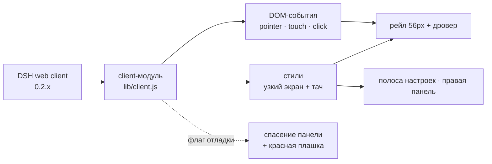

<div align="center">

# DSH Mobile UI

[](#совместимость)
[](LICENSE)
[](#как-это-устроено)
[](#что-чинит)
[](#установка)

</div>


<p><strong>Мобильный интерфейс для Web UI DeepSeek Harness: настоящий дровер, свайпы от края, читаемые настройки и работающая правая панель — без правок ядра.</strong></p>
<p>DSH 0.2.x — десктопный: три колонки, навигация настроек в 188px, правая панель нулевой ширины и композер 14px, из-за которого iOS зумит страницу. На телефоне остаётся полоска чата, нечитаемые настройки и никакого доступа к Files и просмотру кода.</p>
<ul>
<li><strong>Нет автозума iOS</strong> — поля 16px на любом тач-устройстве, даже под широким десктопным макетом</li>
<li><strong>Чат на всю ширину</strong> — рейл 56px и overlay-дровер, плюс свайпы от края</li>
<li><strong>Остальное влезает</strong> — настройки, Files, терминал и просмотр кода</li>
</ul>
<p>Без шага сборки и без кода на Host — один клиентский модуль, лицензия MIT.</p>

<br clear="all">


---

## Что чинит

| Дровер | Настройки | Файлы и код |
| --- | --- | --- |
|  |  |  |

1. **Автозум iOS.** Safari зумит страницу, когда в фокус попадает поле меньше
   16px. На тач-устройстве все `input` / `textarea` / `contenteditable`
   становятся 16px; признак — устройство (`html.dsh-mf-touch`), а не ширина
   окна, поэтому телефон с растянутым десктопным макетом тоже не зумит.
   `touch-action: manipulation` не даёт двойному тапу сдвигать следующий тап
   мимо цели.
2. **Чат на всю ширину.** Колонка сайдбара остаётся рейлом 56px, открытая
   панель — фиксированный дровер поверх контента с затемнением и blur.
3. **Дровер закрывается** при выборе сессии, тапе вне панели и по своей кнопке
   закрытия. Нижняя safe-area учитывается.
4. **Строка сессии открывается с первого тапа.** iOS считает обычный
   `<div role="treeitem">` с React-обработчиком «некликабельным» и придерживает
   его `click` на окно двойного тапа (~300 мс). Дровер закрывался первым и
   размонтировал строку, поэтому тап только закрывал меню. Теперь `click`
   строки отправляется синхронно из `pointerup`, а запоздавший нативный `click`
   того же тапа гасится.
5. **Свайпы от края.** Слева вправо — открыть, справа налево — закрыть.
   Вертикальные жесты остаются скроллу (порог 36px, вертикальный уход до 34px,
   зона края 24px).
6. **Настройки влезают.** Десктопная модалка держит 188px-колонку навигации —
   на 390px контенту оставалось ~150px. На узком экране список разделов
   становится горизонтальной прокручиваемой полосой над контентом, а карточка
   аккаунта ставит имя над ссылкой «More account information», вместо того
   чтобы сжимать его в узкую колонку.
7. **Правая панель работает.** На телефоне её колонка нулевая, поэтому Files,
   терминал и просмотр файлов/кода открывались в никуда. Пока панель открыта
   (`data-sidebar-right-open`), она разворачивается в полноэкранный лист.
8. **Код и таблицы** не расширяют сообщение и скроллятся внутри блока; код в
   просмотрщике файлов — 12px вместо 11px.
9. **Клавиатурная панель iOS не залипает.** В standalone-PWA iOS может
   оставить внизу панель «переход по полям + Готово» после скрытия клавиатуры;
   плагин снимает фокус с поля, когда клавиатура закрывается.

## Установка

```sh
git clone https://github.com/zven73/dsh-mobile-ui.git ~/.dsh/local-plugins/dsh-mobile-ui
dsh plugin --profile web add ~/.dsh/local-plugins/dsh-mobile-ui
```

Для `dsh plugin` нужен `pnpm` в `PATH`. Перезапусти `dsh web` (или дай профилю
пересобраться) и обнови страницу на телефоне. Клиентские бандлы отдаются с
диска с ревизией по содержимому, поэтому дальше достаточно перезагрузить
страницу.

> id пакета остался `dsh-mobile-fix` (репозиторий переименован) — это имя ты
> увидишь в `~/.dsh/profiles/web/package.json`.

### Удаление

```sh
dsh plugin --profile web remove dsh-mobile-fix
```

## Как это устроено



Это обычный клиентский плагин DSH: `cordis.patch.yml` вставляет одну пустую
Host-строку, а `lib/client.js` — браузерный бандл, который DSH отдаёт через
`dsh.client`. Всё, что он делает, — CSS и DOM-события:

- селекторы опираются на устойчивые половины имён CSS-модулей (`sidebarCol`,
  `centerCol`, `rightbarCol`, `sessionRow`, `_root`, `_collapsed`, `toggle`) и
  публичные `data-slot`;
- мобильная раскладка — под `@media (max-width: 1023px)`, правило 16px — под
  классом тач-устройства;
- один набор обработчиков на страницу: повторный `apply` (HMR, live
  composition) заменяет предыдущий, а не наслаивается.

## Совместимость

| DSH | Профиль | На чём проверено | Статус |
| --- | --- | --- | --- |
| `0.2.1-rc.5` | `web` | вьюпорт iPhone 14 (390×844, WebKit) + живой iPhone в PWA | проверено |
| другой `0.2.x` | `web` | — | должно работать; крупный редизайн потребует правки селекторов |
| десктоп ≥ 1024px | `web` | macOS Chrome / Safari | не затрагивается |

## Если что-то не так

| Симптом | Что делать |
| --- | --- |
| На телефоне всё ещё десктопная раскладка | Перезагрузи страницу; проверь, что плагин есть в профиле `web` (`~/.dsh/profiles/web/package.json` → `bundles`) |
| Настройки не открываются или открылись вне экрана | `localStorage.setItem('dsh-mobile-fix-debug', '1')`, перезагрузи, прочитай красную плашку |
| iOS всё ещё зумит поле | Нужна сборка 0.6.3+: правило привязано к тач-устройству, а не к ширине |
| Дровер не закрывается тапом | Проверь на живом телефоне: эмуляция в десктопном браузере иначе шлёт `click` |
| Правая панель пустая | Открывай её из шапки сессии; лист привязан к сессии, а не к приложению |
| Тап по сессии выделяет, но не открывает | Посмотри консоль на ошибку JS; фикс отправляет `click` из `pointerup` |

## Ограничения

- Селекторы опираются на локальные имена CSS-модулей; крупный редизайн
  потребует обновления.
- Правая панель на телефоне — лист, без ресайза.
- Нет service worker и кода на Host: это только клиентский модуль.
- Проверено на iOS; Android Chrome должен работать (правила раскладки по
  ширине), но не тестировался.

## Разработка

| Путь | Что это |
| --- | --- |
| `lib/client.js` | весь браузерный бандл: стили, логика дровера, свайпы, лист настроек |
| `lib/index.js` | пустая Host-половина (валидная запись Loader) |
| `cordis.patch.yml` | вставляет строку плагина в профиль |
| `docs/` | скриншоты и демо-GIF для README |

Правь `lib/client.js`, поднимай `VERSION` и `package.json`, перезагружай
страницу — Host пересобирает бандл на каждый запрос, а URL несёт ревизию по
содержимому. Шага сборки нет.

## Участие

Issues и PR приветствуются. Опиши устройство, версию DSH и что именно видел;
скриншот с телефона полезнее абзаца. Для фикса — не трогай десктопную
раскладку и проверь на 390×844 перед отправкой.

## История версий

См. [CHANGELOG.md](CHANGELOG.md).

## Лицензия

MIT — см. [LICENSE](LICENSE).

---

[English](README.md) · Русский · [中文](README.zh.md)
