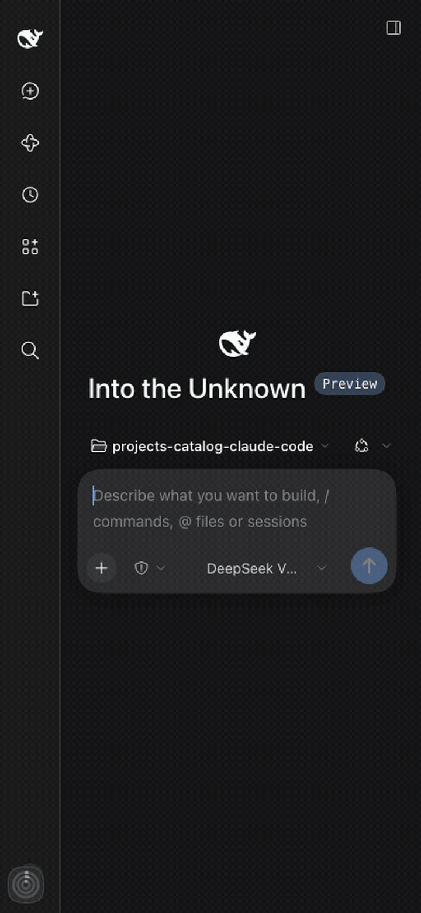
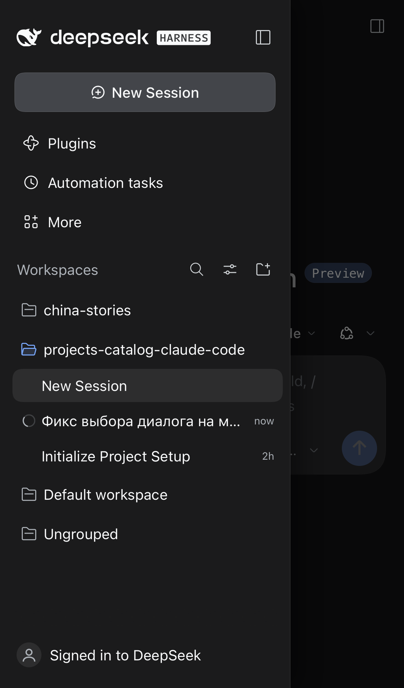
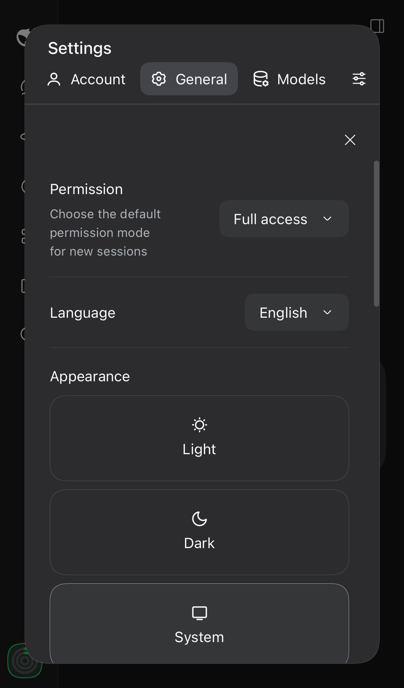
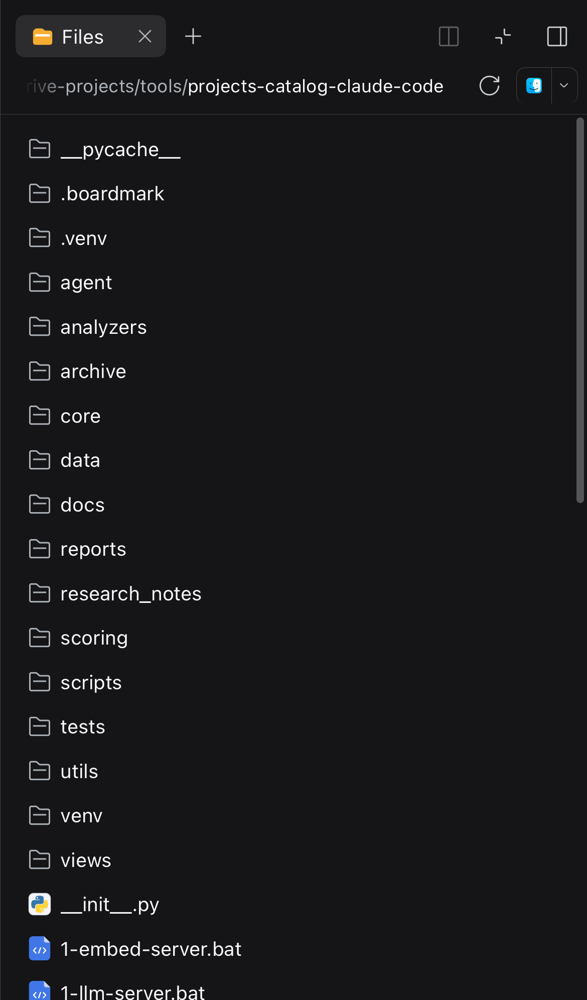
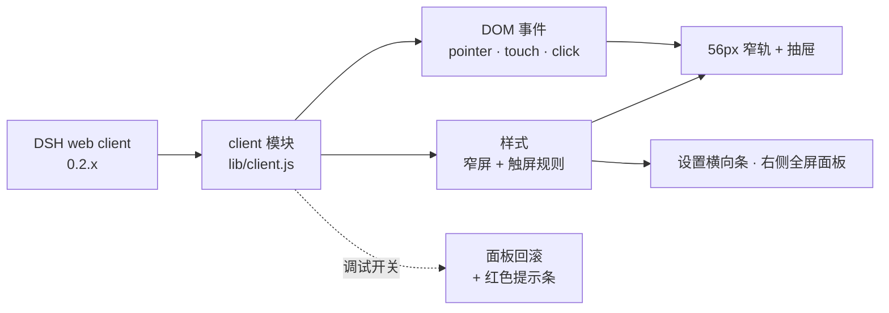

<div align="center">

# DSH Mobile UI

[](#兼容性)
[](LICENSE)
[](#工作原理)
[](#修复内容)
[](#安装)

</div>



<p><strong>为 DeepSeek Harness Web UI 做的手机优先补丁：真正的抽屉、边缘滑动、可读的设置和可用的右侧面板 —— 不改动核心。</strong></p>
<p>DSH 0.2.x 是桌面优先的：三栏网格、188px 的设置导航、宽度为 0 的右侧面板，以及会让 iOS 自动缩放的 14px 输入框。在 390px 宽的手机上，聊天只剩一条窄缝，设置对话框读不清，Files 和代码查看器根本打不开。</p>
<p>本插件从外部修补客户端 bundle：Host 端为空，不复制也不修改任何核心文件，桌面布局保持不变。</p>
<ul>
<li><strong>不再触发 iOS 自动缩放</strong> —— 触屏设备上输入框一律 16px，即使手机显示宽屏桌面布局。</li>
<li><strong>聊天占满宽度</strong> —— 侧边栏变成 56px 窄轨加浮层抽屉。</li>
<li><strong>一次点击就打开会话</strong> —— 行的 <code>click</code> 从 <code>pointerup</code> 同步派发，iOS 来不及丢掉它。</li>
<li><strong>边缘滑动</strong> —— 左缘右滑打开，左滑关闭。</li>
<li><strong>设置读得清</strong> —— 分区变成横向条，内容占满面板。</li>
<li><strong>Files、终端和代码查看器可用</strong> —— 右侧面板在手机上变成全屏面板。</li>
</ul>

<p>没有构建步骤，也没有 Host 代码：整个补丁就是一个客户端模块（<code>lib/client.js</code>），由 DSH 作为浏览器 bundle 提供。MIT 许可。</p>

<br clear="all">


---

## 修复内容

| 侧边抽屉 | 设置 | 文件与代码 |
| --- | --- | --- |
|  |  |  |

1. **iOS 自动缩放。** 聚焦的输入框小于 16px 时 Safari 会缩放页面。触屏设备上所有 `input` / `textarea` / `contenteditable` 都是 16px；判断依据是*设备*（`html.dsh-mf-touch`），不是视口宽度，所以手机显示拉伸的桌面布局时也不会缩放。`touch-action: manipulation` 避免双击把下一次点击带偏。
2. **聊天占满宽度。** 侧边栏始终是 56px 窄轨，打开的面板变成带暗色遮罩和模糊的固定抽屉。
3. **抽屉会自动收起**：选择会话、点击面板外、或点它自己的关闭按钮。底部安全区会考虑。
4. **会话行第一次点击就打开。** iOS 会把只带 React 处理器的 `<div role="treeitem">` 视为「不可点击」，把它的 `click` 推迟到双击窗口之后（约 300ms）。之前抽屉先关闭并卸载了该行，于是点击只关掉了菜单。现在行的 `click` 在 `pointerup` 里同步派发，同一次点击迟到的原生 `click` 会被吞掉。
5. **边缘滑动。** 从左缘向右滑打开，向左滑关闭；垂直拖动留给滚动（阈值 36px，垂直偏移最多 34px，左缘 24px）。
6. **设置适配手机。** 桌面对话框保留 188px 导航列，在 390px 屏幕上内容只剩约 150px。窄屏上分区列表变成内容上方的横向可滚动条。
7. **右侧面板可用。** 手机上它的网格轨道宽度为 0，Files、终端和文件/代码预览等于打开到空气里。面板打开时（`data-sidebar-right-open`）会变成全屏面板。
8. **代码和表格不会撑宽消息**，在块内自行滚动；文件查看器里的代码从 11px 提到 12px。
9. **iOS 键盘附件栏不再残留。** 在独立 PWA 里，键盘收起后 iOS 可能把「上一项/下一项/完成」栏固定在屏幕底部；插件在键盘关闭时移除输入框焦点。

## 安装

```sh
git clone https://github.com/zven73/dsh-mobile-ui.git ~/.dsh/local-plugins/dsh-mobile-ui
dsh plugin --profile web add ~/.dsh/local-plugins/dsh-mobile-ui
```

`dsh plugin` 需要 `PATH` 中有 `pnpm`。重启 `dsh web`（或让 profile 重新合成），然后在手机上刷新页面。客户端 bundle 从磁盘按内容版本提供，之后的更新只需刷新页面。

> 包 id 仍是 `dsh-mobile-fix`（仓库已改名）；在 `~/.dsh/profiles/web/package.json` 里看到这个名字不必奇怪。

### 卸载

```sh
dsh plugin --profile web remove dsh-mobile-fix
```

## 工作原理



这是一个普通的 DSH 客户端插件：`cordis.patch.yml` 插入一条空的 Host 行，`lib/client.js` 是 DSH 通过 `dsh.client` 提供的浏览器 bundle。它做的全部是 CSS 和 DOM 事件：

- 选择器依赖 CSS Module 类名的稳定部分（`sidebarCol`、`centerCol`、`rightbarCol`、`sessionRow`、`_root`、`_collapsed`、`toggle`）以及公开的 `data-slot`；
- 手机布局在 `@media (max-width: 1023px)` 之内，16px 规则在触屏设备 class 之内；
- 每页只注册一组监听器：重复的 `apply`（HMR、实时合成）会替换旧的，而不是叠加。

## 兼容性

| DSH | Profile | 检查环境 | 状态 |
| --- | --- | --- | --- |
| `0.2.1-rc.5` | `web` | iPhone 14 视口（390×844，WebKit）+ 真实 iPhone PWA | 已验证 |
| 其他 `0.2.x` | `web` | — | 应当可用；大幅改版布局需要更新选择器 |
| 桌面 ≥ 1024px | `web` | macOS Chrome / Safari | 按设计不受影响 |

## 遇到问题

| 现象 | 处理 |
| --- | --- |
| 手机上仍是桌面布局 | 刷新页面；确认插件在 `web` profile 里（`~/.dsh/profiles/web/package.json` → `bundles`） |
| 设置打不开，或打开到屏幕外 | `localStorage.setItem('dsh-mobile-fix-debug', '1')`，刷新，读红色提示条 |
| iOS 仍然缩放输入框 | 需要 0.6.2+：规则按触屏设备判断，而不是宽度 |
| 点击无法收起抽屉 | 在真机上试：桌面浏览器模拟的事件顺序不同 |
| 右侧面板是空的 | 从会话头部打开；面板属于会话，不是全局 |
| 点击会话只高亮不打开 | 看控制台是否有 JS 错误；修复是从 `pointerup` 派发 `click` |

## 限制

- 选择器依赖 CSS Module 的本地类名；大幅改版需要更新。
- 手机上的右侧面板是全屏面板，不支持拖拽调整大小。
- 没有 service worker，也没有 Host 代码：只是一个客户端模块。
- 只在 iOS 上验证；Android Chrome 应该可用（布局规则基于宽度），但未测试。

## 开发

| 路径 | 内容 |
| --- | --- |
| `lib/client.js` | 整个浏览器 bundle：样式、抽屉逻辑、滑动、设置面板 |
| `lib/index.js` | 空的 Host 半（合法的 Loader 条目） |
| `cordis.patch.yml` | 把插件行插入 profile |
| `docs/` | README 用的截图和演示 GIF |

改 `lib/client.js`，同时提升 `VERSION` 和 `package.json` 里的版本，刷新页面即可 —— Host 每次请求都重新合成 bundle，URL 带内容版本号。没有构建步骤。

## 参与贡献

欢迎 issue 和 PR。请说明设备、DSH 版本和具体看到的现象；手机截图比一段描述更有用。提交修复时不要改动桌面布局，并在 390×844 下验证。

## 更新记录

见 [CHANGELOG.md](CHANGELOG.md)。

## 许可证

MIT — 见 [LICENSE](LICENSE)。

---

[English](README.md) · [Русский](README.ru.md) · 中文
